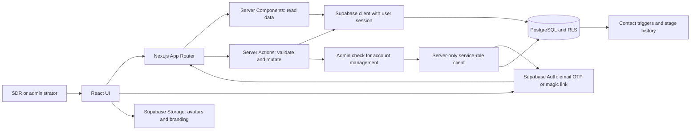

# SalesNova

**A sales CRM that connects lead qualification, customer activity, and opportunity reporting in one workspace.**

Built with **Next.js 16 · React 19 · TypeScript · Supabase/PostgreSQL · Tailwind CSS 4**.

[Technical write-up](docs/TECHNICAL_WRITEUP.md) · [Deployment notes](DEPLOYMENT.md) · [Source code](https://github.com/moizbroad/SalesNova)

## The problem

Sales follow-up depends on context: who owns a lead, what was discussed, which stage it has reached, and what should happen next. When that information is spread across separate records, answering a simple question like “Which opportunities need attention?” requires reconstructing the history manually.

SalesNova addresses that workflow by connecting contacts, conversations, meetings, qualification stages, and deals. Sales development representatives (SDRs) work the contact pipeline; administrators manage opportunities and review pipeline performance.

This describes the product's intended use. The team's previous tools, adoption figures, and measured business impact have not been documented in this repository.

## What the code delivers

| Capability | User workflow | Implementation |
| --- | --- | --- |
| Contact management | Record contact details, source, owner, status, and next action | [Contact actions](app/%28app%29/contacts/actions.ts) |
| Lead pipeline | Move contacts through stages using a board or searchable, filterable table | [Contact UI](components/contacts) |
| Customer context | Log notes, LinkedIn/email conversations, and meetings with rich-text notes | [Activity actions](app/%28app%29/contacts/%5Bid%5D/activity-actions.ts) |
| Stage history | See when a contact entered each stage; database triggers record transitions | [Initial schema](supabase/migrations/0001_initial_schema.sql) |
| Opportunity management | Convert a contact into a deal, record value and expected close date, and move it through a deal pipeline | [Deal actions](app/%28app%29/deals/actions.ts) |
| Reporting | Filter contact and deal metrics by owner, source, and date; inspect proposal, won/lost, and open-pipeline metrics | [Dashboard](components/dashboard/dashboard-view.tsx) · [Deal reports](components/deals/deals-reports-view.tsx) |
| Account administration | Sign in with an email code or magic link; admins manage accounts and branding | [Login](app/login/page.tsx) · [Settings](app/%28app%29/settings/actions.ts) |

Outreach and meetings are **recorded manually**. Email sending, calendar synchronization, and automated outreach are not implemented.

### Example workflow

1. An SDR adds a contact, records its source, and assigns an owner.
2. The SDR logs conversations and meetings, updates the next action, and advances the qualification stage.
3. An admin converts the contact into an opportunity. The conversion action reuses an existing open deal when one is found.
4. The admin tracks the deal through Discovery, Proposal Sent, Negotiation, Verbal Yes, and Closed Won/Lost.
5. Reports combine current pipeline state with recorded stage transitions.

### Implementation status

- **CRM application:** contact, activity, deal, reporting, authentication, and settings code is present.
- **Database setup blocker:** [`0004_deals.sql`](supabase/migrations/0004_deals.sql) currently contains only `l`. The deal tables, policies, and triggers cannot be recreated from this checkout. A complete fresh setup requires restoring that migration.
- **Claude + MCP:** proposed extension; no MCP server, Claude integration, tool definitions, or AI evaluation results are present in this repository.
- **Public demo:** no verified demo URL or synthetic-data seed is supplied.

## Architecture



Protected requests pass through [`proxy.ts`](proxy.ts) and the Supabase session helper. Server Components load data; Server Actions validate mutations and revalidate affected pages. Foreign-key relationships supply owner and contact details in the same Supabase query.

Normal CRM queries use the signed-in user's session. A separate service-role client supports account administration and bypasses RLS, so it is isolated in a `server-only` module behind application role checks.

### Technology stack

| Layer | Technology and role |
| --- | --- |
| Application | Next.js **16.2.9**, App Router, Server Components, Server Actions |
| UI | React **19.2.4**, TypeScript **5**, Tailwind CSS **4** |
| Data and authentication | Supabase JavaScript SDK, Supabase SSR, PostgreSQL, email OTP/magic links |
| Media | Supabase Storage for profile avatars and company branding |
| Reporting | Recharts **3**; current aggregations run in the browser |
| Rich text | Tiptap **3** for meeting notes |
| Runtime | Node.js **22** via `.nvmrc`; npm lockfile included |
| Hosting | Existing deployment notes describe a hosted Next.js app with Supabase; live hosting is unverified |
| AI | Claude/MCP design proposal in the technical write-up; no runtime integration yet |

## Claude and MCP: proposed next step

A conversational interface could reduce the work of navigating filters and reconstructing customer context. Example questions would include “Which contacts need follow-up this week?”, “Summarize this contact's recent conversations,” and, for an admin, “How much pipeline is in Proposal Sent?”

The proposed flow is **user → Claude → authenticated, read-only MCP tools → permission-scoped database queries → structured results → answer with record references**. It would use explicit business tools instead of model-generated SQL. Writes, bulk exports, user administration, and arbitrary SQL would remain unavailable to Claude.

See the [proposed tool contracts, authentication boundary, and evaluation plan](docs/TECHNICAL_WRITEUP.md#proposed-claude-and-mcp-extension). These describe future work, not completed features.

## Security and current boundaries

- `.env*` files are ignored, including templates. Create local configuration yourself; never commit real keys or sign-in links.
- The service-role key belongs on the server. Browser code uses the public Supabase URL and anon key; database policies must enforce access.
- Admin checks exist in deal routes and mutations, and account-management actions. Deal RLS cannot be verified because its migration is missing.
- Contact and activity policies currently allow shared read/write access to authenticated users. **Per-owner isolation and multi-tenant isolation are not implemented.**
- The shipped profile policy allows users to update their own row without restricting sensitive columns such as `role`. This needs database-level hardening before relying on role boundaries in an untrusted deployment.

Additional review findings—including inactive-account enforcement and rich-text sanitization—are recorded in the [technical write-up](docs/TECHNICAL_WRITEUP.md#security-review-and-known-gaps).

## Local setup

**Full database reproduction is currently blocked by the incomplete deals migration.** The steps below configure the application and available base schema; they do not repair that missing schema.

### 1. Install dependencies

Use Node.js 22, matching `.nvmrc`:

```bash
git clone https://github.com/moizbroad/SalesNova.git
cd SalesNova
npm ci
```

### 2. Create local configuration

Create an untracked `.env.local` file with these variable names and values from your own Supabase project:

```dotenv
NEXT_PUBLIC_SUPABASE_URL=your-supabase-project-url
NEXT_PUBLIC_SUPABASE_ANON_KEY=your-supabase-anon-key
SUPABASE_SERVICE_ROLE_KEY=your-server-only-service-role-key
```

These are placeholders. No environment file or credentials are distributed with the repository.

### 3. Prepare the database

In a separate development Supabase project, apply these files in order:

1. [`0001_initial_schema.sql`](supabase/migrations/0001_initial_schema.sql): profiles, settings, contacts, activities, contact history, and policies.
2. [`0002_avatars_storage.sql`](supabase/migrations/0002_avatars_storage.sql): avatar storage.
3. [`0003_branding_storage.sql`](supabase/migrations/0003_branding_storage.sql): branding storage.

**Do not execute the current `0004_deals.sql`.** Restore the actual deals schema and its security policies before testing deal workflows or treating setup as complete.

### 4. Configure sign-in

Create the first user in Supabase Authentication, then promote its generated profile in the SQL editor:

```sql
update public.profiles
set role = 'admin', is_active = true
where email = 'your-admin-email@example.com';
```

Configure the development Site URL as `http://localhost:3000` and the allowed callback as `http://localhost:3000/auth/callback`. The login page accepts a six-digit email code; its email template must include `{{ .Token }}`. Magic links are handled by `/auth/callback`. See [deployment notes](DEPLOYMENT.md) for the existing configuration guide.

### 5. Start the application

```bash
npm run dev
```

Open `http://localhost:3000`. Use your own development accounts and synthetic records. Shared demo credentials and an automated seed are not included.

## Validation and engineering evidence

| Command | Purpose |
| --- | --- |
| `npm run dev` | Local development |
| `npm run lint` | ESLint checks |
| `npx tsc --noEmit` | Type checking after installing dependencies |
| `npm run build` | Production compilation |
| `npm start` | Serve the production build |

There is no committed automated test suite or CI workflow in this checkout. Passing lint or a build would not establish database authorization, workflow correctness, or AI quality. The [technical write-up](docs/TECHNICAL_WRITEUP.md) maps implementation decisions to source files and defines a manual validation plan, current limitations, and evaluation targets.

## Repository map

```text
app/                    Routes, layouts, authentication callback, Server Actions
components/             Contact, deal, reporting, profile, and settings UI
lib/supabase/           Browser, session-aware server, and privileged clients
lib/types.ts            Domain types and pipeline stages
proxy.ts                Request/session handling
supabase/migrations/    Base schema and storage policies; deals migration incomplete
scripts/                Administrative account/link helper
docs/TECHNICAL_WRITEUP.md  Architecture analysis and proposed AI extension
```

## Evidence and roadmap

The [GitHub repository](https://github.com/moizbroad/SalesNova) is public. A verified deployment URL, measured business results, individual contribution breakdown, and historical AI-development examples have not yet been supplied. No claims about those are made here.

Next priorities are to restore the deals migration, strengthen database authorization, add repeatable workflow and security tests, move large-list filtering/reporting to bounded server queries, and then implement and evaluate the read-only MCP extension.
