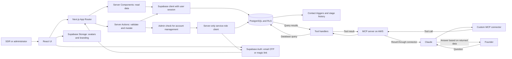

# SalesNova — AI-Powered Sales CRM

**Manage the sales pipeline in one workspace and ask Claude questions about CRM data through a custom MCP connector.**

Next.js 16 · React 19 · TypeScript · Supabase/PostgreSQL · Tailwind CSS · Claude · MCP · AWS

[Technical overview](docs/TECHNICAL_WRITEUP.md) · [Deployment guide](DEPLOYMENT.md)

## Problem and solution

Sales teams need a clear view of who owns each lead, what happened in the last conversation, and what needs to happen next. SalesNova connects contacts, outreach history, meetings, and opportunities so follow-up and pipeline reporting use the same records.

SDRs manage lead qualification, admins manage deals, and the founder can ask Claude about data exposed by the CRM's MCP tools. The AWS-hosted MCP server retrieves database results for Claude to turn into an answer.

## Core features

- **Contact pipeline:** board and table views, ownership, lead sources, qualification stages, and next actions.
- **Activity history:** notes, manually logged email/LinkedIn conversations, meetings, and automatic contact stage history.
- **Deal management:** contact-to-opportunity conversion, deal values, expected close dates, and stages from Discovery to Closed Won/Lost.
- **Sales reporting:** owner, source, and date filters; open pipeline, proposal activity, and won/lost metrics.
- **Accounts and branding:** email-code or magic-link login, admin/SDR application roles, user management, and company branding.
- **Conversational access:** Claude uses a custom connector to call MCP tools that retrieve CRM data.

## Architecture



The web application uses Server Components for reads and Server Actions for mutations. Supabase provides authentication, PostgreSQL, and media storage. A separate server-only client handles privileged account administration.

The MCP service runs separately on AWS. Claude calls its tools through the custom connector, the tool handlers query the database, and Claude answers using the returned data. This repository contains the CRM application; the MCP server and connector configuration are maintained separately.

## Technology stack

| Layer | Technologies |
| --- | --- |
| Application | Next.js 16 App Router, React 19, TypeScript |
| Interface | Tailwind CSS 4, Recharts, Tiptap |
| Data and identity | Supabase PostgreSQL, Auth, Storage, and SSR clients |
| AI integration | Claude, custom MCP connector, AWS-hosted MCP server |
| Runtime | Node.js 22, npm |

## Engineering highlights

- **Relational data model:** contacts link to owners, activities, and stage history; Supabase queries embed related records.
- **Database-driven history:** contact stage transitions are recorded by triggers, independently of the UI.
- **Server-side checks:** mutation handlers validate sessions and inputs; deal and account-management actions check the admin role.
- **Tool-based AI access:** MCP connects natural-language questions to database retrieval through server-side handlers.

See the [technical overview](docs/TECHNICAL_WRITEUP.md) for the data model, MCP sequence diagram, and current trade-offs.

## Run locally

Use Node.js 22 and a development Supabase project.

```bash
git clone https://github.com/moizbroad/SalesNova.git
cd SalesNova
npm ci
```

Create a local `.env.local` with your own values:

```dotenv
NEXT_PUBLIC_SUPABASE_URL=your-supabase-project-url
NEXT_PUBLIC_SUPABASE_ANON_KEY=your-supabase-anon-key
SUPABASE_SERVICE_ROLE_KEY=your-server-only-service-role-key
```

All `.env*` files are ignored. Keep the service-role key on the server.

Follow the [deployment guide](DEPLOYMENT.md) to configure the database, first admin account, and authentication callback, then run:

```bash
npm run dev
```

Open `http://localhost:3000`.

**Setup note:** `supabase/migrations/0004_deals.sql` is incomplete. Restore the deals schema before attempting a full fresh deployment. The [technical notes](docs/TECHNICAL_WRITEUP.md#current-limitations) cover the remaining limitations.

## Development commands

| Command | Purpose |
| --- | --- |
| `npm run dev` | Local development |
| `npm run lint` | ESLint checks |
| `npm run build` | Production build |
| `npm start` | Serve the production build |

## Source guide

| Directory | Responsibility |
| --- | --- |
| `app/` | Routes, layouts, authentication callback, and Server Actions |
| `components/` | Contact, deal, reporting, profile, and settings interfaces |
| `lib/` | Domain types and Supabase clients |
| `supabase/migrations/` | Database schema, triggers, and storage policies |
| `docs/` | Architecture and implementation details |
