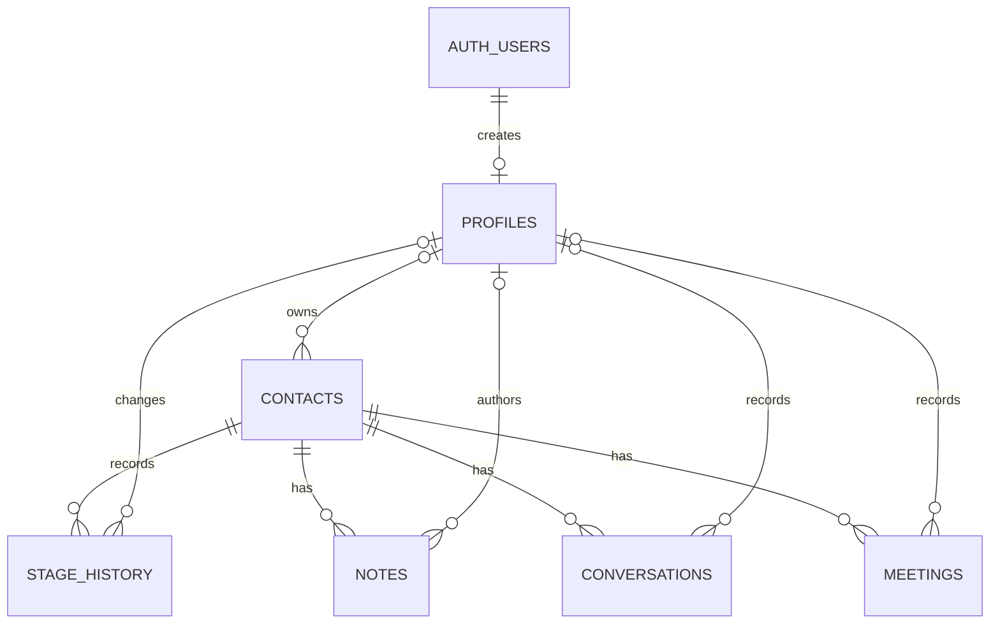
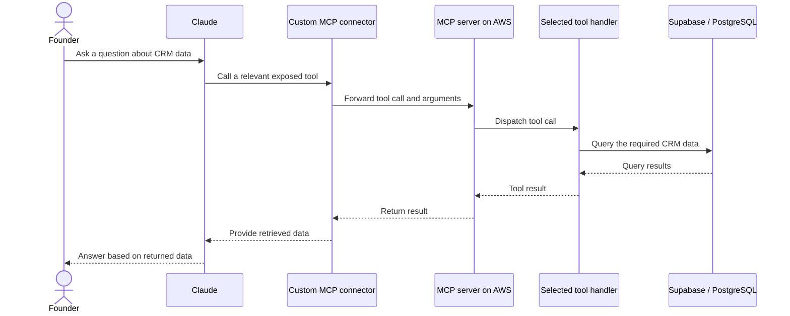

# SalesNova — Technical Overview

[Back to README](../README.md)

SalesNova combines a Next.js sales workspace with a separately hosted Claude/MCP integration. Both work with the CRM's Supabase/PostgreSQL data.

## Application flow

1. [`proxy.ts`](../proxy.ts) and the [session helper](../lib/supabase/middleware.ts) validate the session and route unauthenticated visitors to login.
2. Server Components load records through a [cookie-backed Supabase client](../lib/supabase/server.ts). Related owners and contacts are embedded through foreign-key queries.
3. Client components provide tables, filters, charts, rich-text notes, and pipeline boards.
4. Server Actions check authentication, validate inputs, write changes, and revalidate affected pages. Deal and account-management actions also check the admin role.
5. Contact triggers record initial stages and transitions. A separate [server-only client](../lib/supabase/admin.ts) supports privileged account management.

## Data model

The base schema connects each contact to its owner and activity history:

Foreign keys maintain relationships; indexes support owner, stage, and activity lookups. The application also uses deals, deal notes, and deal stage history. Their migration needs restoration in this checkout.

## Claude and MCP integration

The founder asks Claude a question about CRM data. A custom connector links Claude to the MCP server on AWS, which dispatches tool calls, queries the database, and returns results for the answer.

The connector represents Claude's configured connection to the remote server. The MCP service and its deployment configuration are maintained outside this repository. Available data and actions depend on the tools exposed by that service; its exact tool schemas and authentication configuration are not included here.

## Design choices and trade-offs

| Choice | Benefit | Trade-off |
| --- | --- | --- |
| Next.js Server Components and Actions | UI and server logic share a TypeScript application | Every mutation needs its own validation and authorization |
| PostgreSQL relationships and enums | Consistent stages and linked business records | Migrations must stay aligned with application types |
| Contact history triggers | Stage recording works independently of UI interactions | Current policies do not make history immutable |
| Separate privileged client | Isolates account-administration operations | Service-role access bypasses RLS and requires guarded call sites |
| Browser-side filters and charts | Straightforward interactive reporting | Larger datasets need server-side pagination and aggregation |
| MCP tool layer | Connects conversational questions to database retrieval | Tool permissions and result correctness require separate testing |

The [conversion action](../app/%28app%29/deals/actions.ts) reuses an existing open deal when found. The lookup, insert, and contact update are separate operations; a transaction and uniqueness constraint would improve concurrency handling.

## Reporting behavior

[Contact reports](../components/dashboard/dashboard-view.tsx) combine current pipeline state with stage transitions. [Deal reports](../components/deals/deals-reports-view.tsx) count transitions into proposal and closed stages within a date range.

Win rate is won transitions divided by won plus lost transitions. Stage re-entry can count a deal more than once, historical totals use current deal values, and currencies are not normalized. These are useful boundaries when interpreting the current reports.

## Current limitations

- **Fresh setup:** the deals migration is incomplete; restore it to reproduce the full database and deal policies.
- **Authorization:** contacts and activities currently have shared authenticated access. Profile policies need column restrictions on role changes, and active-account enforcement needs to cover existing sessions. Application guards alone do not establish database isolation.
- **Content handling:** stored meeting HTML needs server-side sanitization; activity policies need tighter edit permissions.
- **Scale and reliability:** add server-side pagination, distinguish read errors from empty results, and make conversion atomic.
- **Validation:** no automated test suite is committed. Priority coverage is contact history, duplicate conversion, direct database authorization, report totals, and MCP tool responses using synthetic data.

Environment files are excluded from Git. Use a separate development database and keep privileged credentials on the server. See the [deployment guide](../DEPLOYMENT.md) for configuration.
