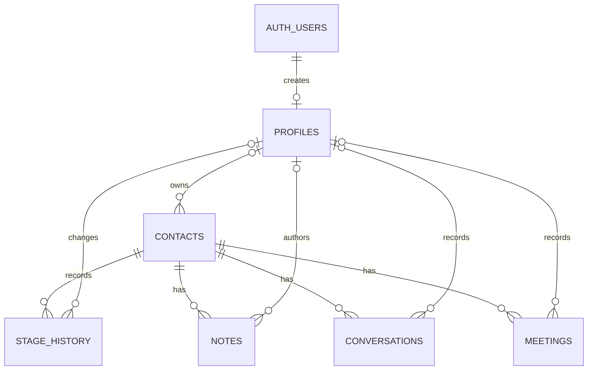
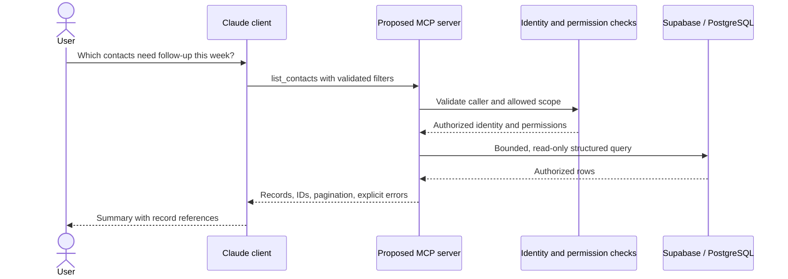

# SalesNova: technical write-up

This document connects the CRM's business workflow to its implementation. It distinguishes source-backed behavior from proposed engineering work. It is not a claim of production validation or a record of individual authorship.

## Problem and solution

A sales workflow needs a consistent answer to three questions: where is each lead, what happened last, and what should happen next? SalesNova models that context using contacts, owners, activities, qualification stages, and opportunities.

The application separates contact work for SDRs from opportunity administration. It combines searchable tables, pipeline boards, activity timelines, and reporting so the same records support day-to-day follow-up and management review.

The actual pre-project workflow, why the team chose a custom CRM over a commercial product, and any measured time savings require first-hand evidence from the project owner. They cannot be established from source code.

## Implemented request and data flow

1. The browser requests an application route. [`proxy.ts`](../proxy.ts) invokes the [session helper](../lib/supabase/middleware.ts), which validates the user through `auth.getUser()` and redirects unauthenticated users to login.
2. The protected [layout](../app/%28app%29/layout.tsx) loads profile and branding information. Deal pages additionally check the profile's admin role.
3. Server Components query Supabase using the [cookie-backed client](../lib/supabase/server.ts). Independent reads use `Promise.all` in list, detail, and report pages.
4. Client components provide filters, tables, charts, rich-text editing, and drag-and-drop interactions.
5. Server Actions authenticate again, validate relevant inputs, perform writes, and call `revalidatePath`. Contact stage triggers create history records inside the database.
6. Account-management actions check the admin role before using the [service-role client](../lib/supabase/admin.ts). This client bypasses RLS and is marked `server-only`.

### Data relationships

The following relationships exist in the base migration:

Contact children use foreign keys with cascading deletion; owner/author references generally become null when the referenced profile is deleted. Indexes cover contact ownership, stages, and activity lookups. The application also expects `deals`, `deal_stage_history`, and `deal_notes`, with contact and profile relationships, but their SQL definition is absent from the one-character deals migration.

### Retrieval, pagination, and errors

Supabase queries embed related records, for example `owner:owner_id(full_name, email)` and `contact:contact_id(id, name, company)`. Detail queries select activities by parent ID and order them by date.

List pages fetch their result set before the browser filters it. They do not implement server-side pagination. Larger datasets may therefore be limited by API row caps, and browser-side aggregates may be incomplete. A future implementation should use bounded pages and database aggregates over the full authorized dataset.

Mutation actions generally return `{ error }` or `{ ok: true }`. Forms display errors and board components revert optimistic stage changes on failure. Empty-state messages exist for contacts, deals, activities, and reports. Several read paths ignore query errors and substitute empty arrays, while detail pages may treat a failed read as not found; missing data and infrastructure failures are not consistently distinguished.

## Engineering choices visible in the code

These are consequences of the implemented design, not claims about the author's original decision-making process.

| Choice | What it enables | Trade-off |
| --- | --- | --- |
| Next.js pages and Server Actions in one application | UI and server mutations share types and deployment | Mutations still require explicit authentication and validation |
| PostgreSQL relationships and enums | Structured stages, foreign-key consistency, related-record queries | Schema migrations must stay synchronized with application code |
| Database triggers for contact history | Stage recording does not depend on each UI remembering to write history | History is currently mutable under broad authenticated policies |
| Supabase Auth and session-aware clients | Managed identity with database policy enforcement | Incorrect policies undermine application role checks |
| Separate service-role client | Server-side account provisioning | Privileged credentials require narrow, reviewed call sites |
| Browser-side filtering and reporting | Simple interactive views for a small dataset | Full-dataset loading and API row caps limit scale and accuracy |
| Existing-open-deal lookup during conversion | Reuses a deal during sequential repeat conversions | Lookup and insert are not atomic; concurrent requests can duplicate deals |

Conversion also updates the contact status after inserting a deal without a transaction, and does not check that status update's error. A database transaction or RPC with a suitable uniqueness rule would make this workflow more reliable.

### Reporting semantics

Contact reports distinguish current stages from transitions recorded over time. Deal reports count history entries into Discovery, Proposal Sent, Closed Won, and Closed Lost within the selected date range.

The displayed win rate is `won transitions / (won transitions + lost transitions)`, rounded to a percentage, with zero for an empty denominator. Re-entering a stage can count a deal more than once. Historical value totals use each deal's current value, rather than a value snapshot from the transition. Reports also sum values without currency conversion. These semantics should be explicit in any future KPI specification and tests.

## Security review and known gaps

The following findings are based on committed source, not testing against a live Supabase database:

| Area | Current behavior and implication |
| --- | --- |
| Credentials | `.env*` is ignored; the admin module imports `server-only`. This does not constitute a full historical secret audit. |
| Shared contact access | Contact and activity policies allow all authenticated users to read/write. Owner assignment is metadata, not an access boundary. |
| Profile updates | `profiles_update_own` checks row ownership but does not restrict `role` or `is_active`. No column-level protection is supplied in the migrations; role changes need database enforcement. |
| Deal authorization | Routes and Server Actions check the admin role. The missing deals migration prevents verification of its database policies. |
| Account deactivation | OTP completion and callback code check `is_active`; normal request/session validation and action guards do not consistently recheck it. Immediate revocation is not established. |
| Note editing | An action restricts note edits to admins, but the base notes policy still allows authenticated writes through the data API. |
| Rich-text notes | Meeting HTML is rendered with `dangerouslySetInnerHTML`; no server-side HTML sanitizer is visible. Treat stored HTML as untrusted. |
| History integrity | Contact history is trigger-generated but the policy also permits authenticated updates/deletes; it is not an immutable audit log. |
| Storage | Avatar and branding buckets are public; upload policies are scoped to user paths or admins. They are not private document storage. |

Before using this as an untrusted or multi-tenant service, tighten database policies and profile column permissions, enforce active-user checks, sanitize rich text, and validate access through the Supabase API as well as the UI. Restore and review deal policies before claiming database-level role isolation.

## Proposed Claude and MCP extension

**Status: design proposal only.** No MCP server, Claude API client, connector configuration, tool handlers, or integration tests were found in this checkout. An externally hosted integration, if one exists, needs separate evidence.

The additional problem this extension would address is navigating business data in natural language: finding relevant records and summarizing context without manually opening several screens. Its value should be measured against the existing UI and reports.

### Proposed tool contracts

These names and schemas are examples for future implementation. They are not callable tools in this repository.

| Tool | Proposed input | Proposed output |
| --- | --- | --- |
| `list_contacts` | Optional stage, owner ID, follow-up date range, cursor; page size capped at 50 | Minimal contact fields, record IDs, next cursor |
| `get_contact_activity` | Contact UUID, optional date range, activity type, cursor | Authorized notes, conversations, or meetings with timestamps and IDs |
| `list_deals` | Stage, owner ID, cursor; admin access required | Authorized deal summaries and next cursor |
| `get_pipeline_summary` | Date range, optional owner/source; admin access required | Database-computed counts and values with currency and metric definitions |

Validate UUIDs, enums, date ranges, text lengths, and pagination limits on the server. Derive identity from verified credentials, never from an `acting_user_id` argument supplied by the model. Return a stable envelope such as `{ data, next_cursor, error }`, and distinguish an authorized empty result from permission denial or database failure.

### Authentication and permissions to implement

The MCP transport and credential flow have not been selected. The implementation must authenticate its caller, map that identity to a CRM user, validate the active account and role on each request, and apply database-enforced scope. Browser login cookies alone do not establish an MCP client's identity.

A service-role credential must not be exposed to Claude or used as a shortcut around user permissions. The existing profile and contact policy gaps need to be resolved before relying on this boundary. Tests must include direct tool invocation and direct data access, not only chat prompts.

### Why read-only tools and structured queries?

Read-only business tools would bound what the assistant can do and separate answer generation from mutations. The proposed server would expose no arbitrary SQL, deletes, account changes, outbound messaging, or unrestricted exports. Tools would supply deterministic filters and aggregates while Claude interprets questions and summarizes results.

Contacts, stages, ownership, dates, and deal amounts already have structured fields, so ordinary database queries are the first proposed retrieval mechanism. RAG pipelines, embeddings, and vector search are not implemented. Semantic retrieval for free-text notes could be evaluated later if keyword/structured retrieval proves insufficient.

Bounded result sizes, field selection, aggregate tools, and explicit cursors would reduce unnecessary context. Summaries should include record references and treat retrieved note content as data, not instructions. No model version, latency budget, operating cost, or model comparison has been measured; choosing Claude here reflects the proposed project direction, not evidence that it outperforms alternatives.

## Validation plan and results

There is no committed automated test suite, CI workflow, benchmark report, or AI evaluation dataset. The following is a plan, not a record of passed tests. Use an isolated development database and synthetic data after restoring the missing schema.

| Scenario | Verification |
| --- | --- |
| Contact lifecycle | Create a synthetic contact, update its stage, and compare history against direct SQL reads |
| Activity relationships | Attach a note, conversation, and meeting; verify parent IDs, author IDs, ordering, and empty states |
| Conversion | Convert twice; confirm sequential reuse, then test simultaneous requests and partial write failure |
| Reports | Compare a small known dataset with independently computed totals; include reopened deals, empty data, and multiple currencies |
| Authentication | Test invalid/expired OTPs, callbacks, signed-out routes, and deactivated existing sessions |
| Authorization | Use admin and SDR sessions to call actions and Supabase directly; attempt role self-escalation, note edits, and deal access |
| Failure handling | Simulate database rejection and unavailable data; verify failures are not presented as successful empty results |
| Proposed MCP | Validate tool arguments, pagination, empty results, permission denial, injected instructions in notes, and record-grounded answers |

A future AI evaluation set should pair each question with expected tool selection, arguments, authorized records, and answer facts. Measure tool-selection accuracy, result correctness, unsupported claims, authorization failures, and end-to-end p50/p95 latency. Track token use and cost per question. No scores or business improvements are claimed yet.

## Deployment, ownership, and interview evidence

| Evidence | Current status |
| --- | --- |
| Source | [Public SalesNova repository](https://github.com/moizbroad/SalesNova) |
| Deployment | Configuration notes exist; no verified live demo URL supplied |
| Reproducibility | npm lockfile and base migrations exist; deals migration is incomplete |
| Demo dataset | No synthetic seed or shared demo credentials supplied |
| Personal contribution | Not established by this review; commit history alone does not prove individual ownership of every feature |
| Business results | No measured before/after results supplied |
| Publication rights | Company branding remains in code; ownership/permission is not established by repository visibility, and no license file is supplied |

For an interview, add first-hand evidence of which modules you designed, implemented, tested, and deployed; the hardest bug you personally debugged; and a specific trade-off you made. Support each with a commit, reproducible example, or artifact. Do not describe proposed tools or test cases as completed work.

## AI-assisted development

The current documentation pass used Codex to inspect routes, actions, schema, policies, and reporting logic, identify mismatches in the previous README, and organize this source-backed write-up. It did not validate a live deployment or implement the proposed AI integration.

Historical use of Claude Code or other assistants during application development has not been supplied. Neither AI-generated test coverage nor a completed LLM security stress test can be claimed from the available evidence.

Useful evidence to add is a concrete suggestion you accepted or rejected, the reason, and the independent check used to verify it—for example a failing regression test, SQL result comparison, or direct authorization test. A generated explanation or code review is not a substitute for those checks.

## Next engineering priorities

1. Restore the deals migration and prove a clean database setup is reproducible.
2. Harden role changes, active-user enforcement, activity policies, and stored HTML handling.
3. Make conversion atomic and define reporting behavior for stage re-entry and currencies.
4. Add workflow, authorization, and regression tests using synthetic fixtures.
5. Introduce server-side pagination and database aggregates for larger datasets.
6. Implement the proposed MCP tools, then measure correctness, authorization, latency, and usefulness.
